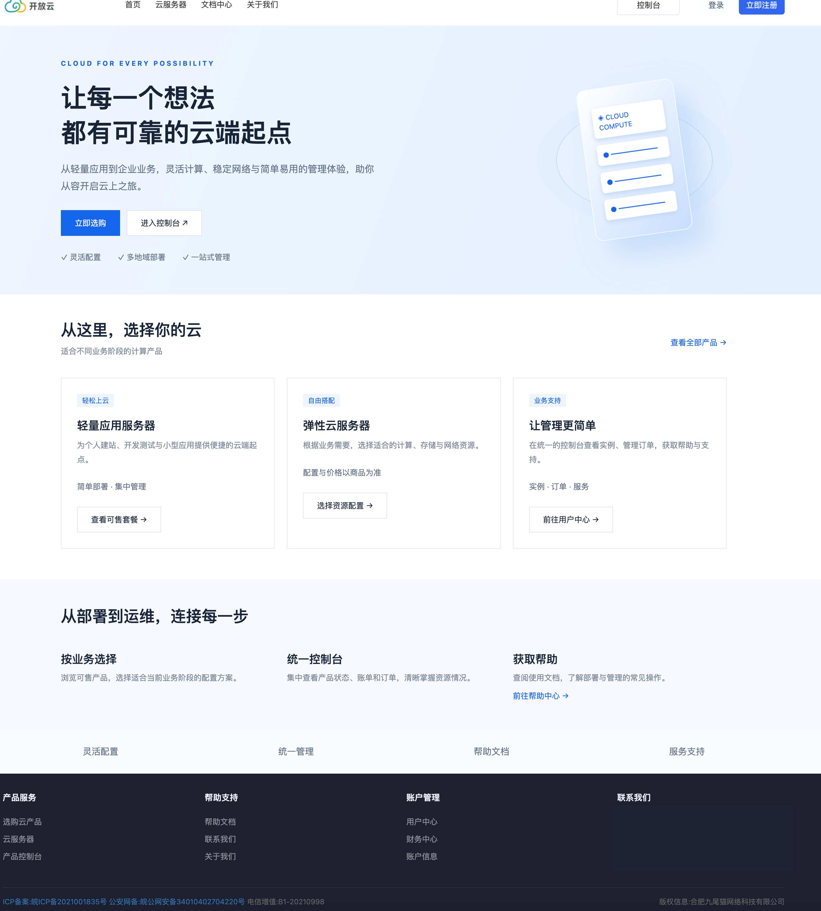
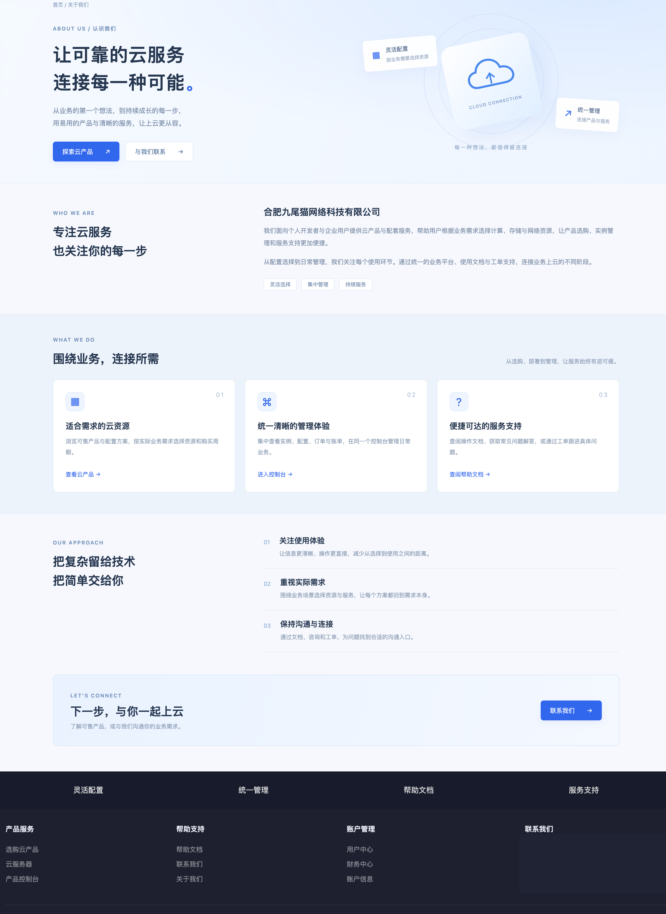
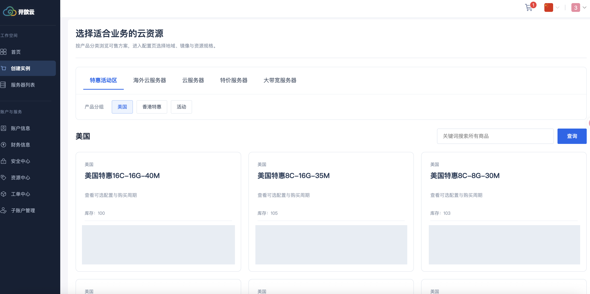
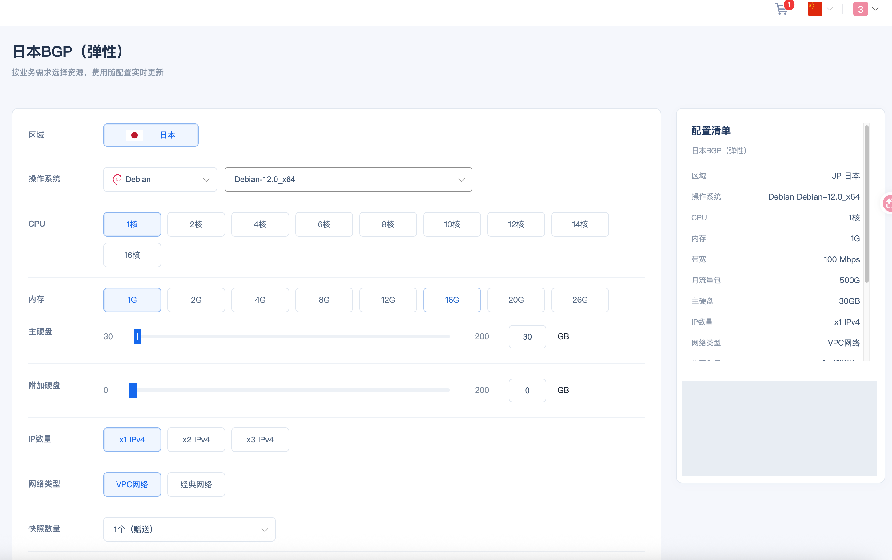
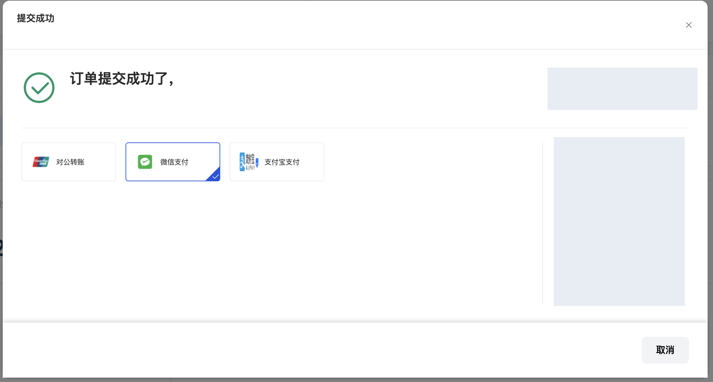
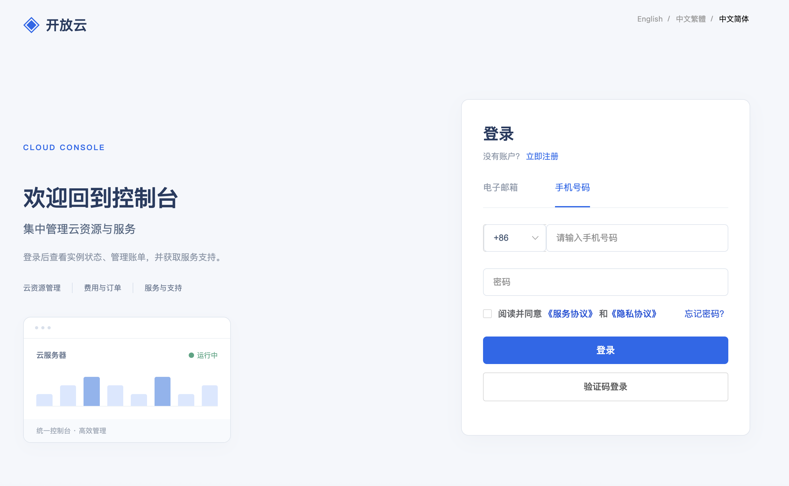
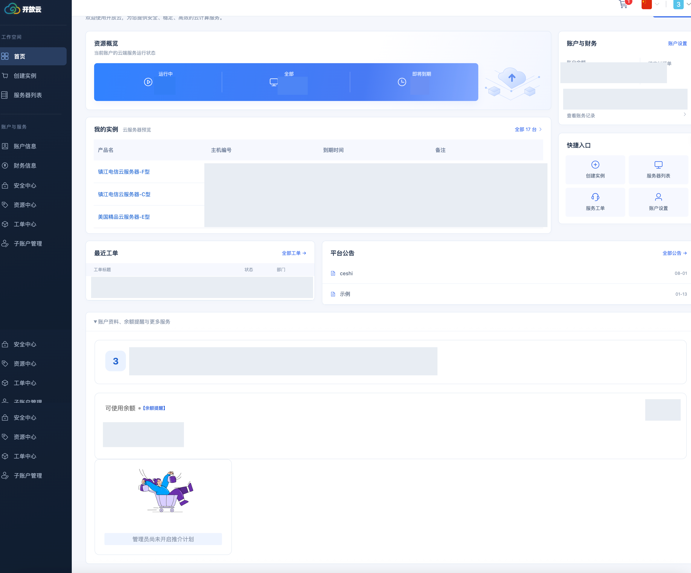
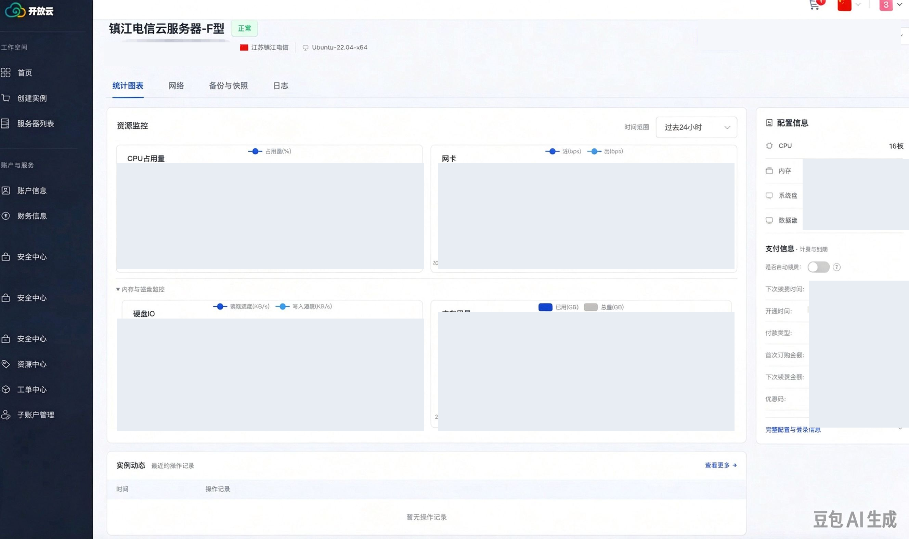
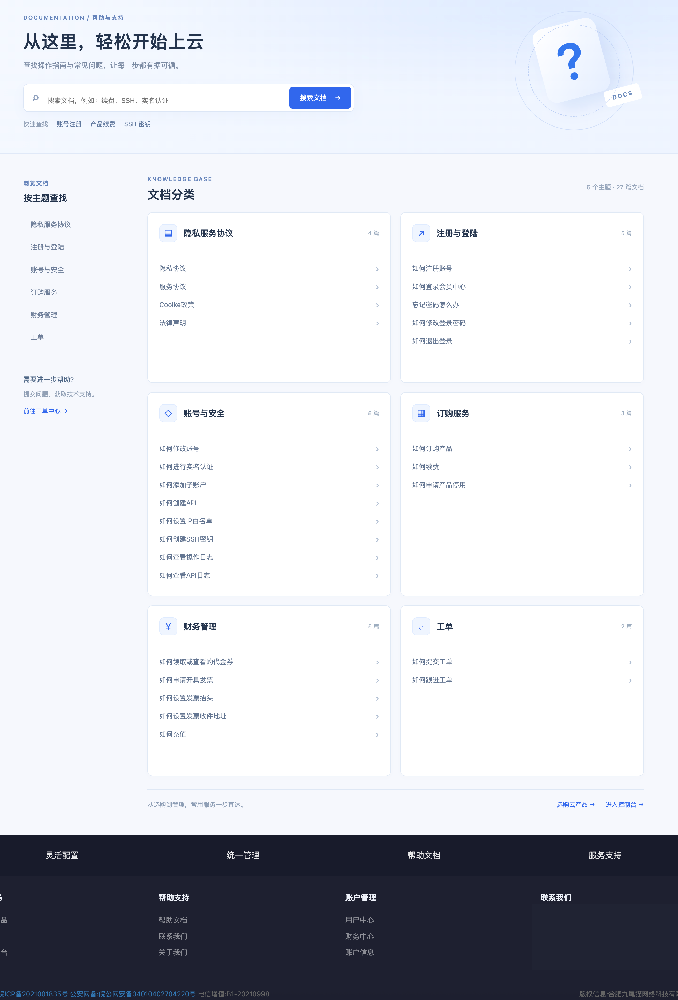
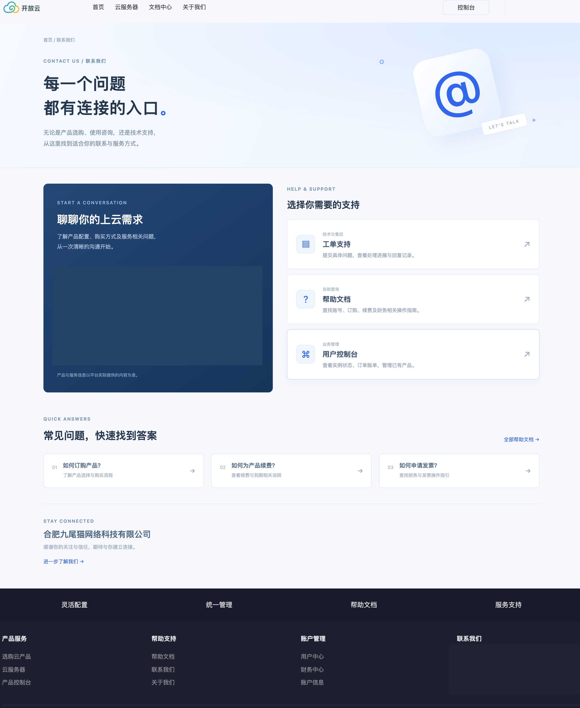

# 智简魔方 V10 · 云序主题

云序主题使用浅色背景和蓝色按钮。偏商务风格的 IDC 站可以从首页进入商品列表，对照用户实际会经过的选购、付款提示和服务页面。

图集按首页、选购、结算、登录和售后操作排列。截图中的账户信息、订单编号、二维码和部分数字已遮挡。

## 界面预览

### 官网首页

### 产品介绍

### 商品列表

### 商品选购

### 订单提交界面

### 登录页

### 用户中心

### 服务详情与监控

### 帮助中心

### 联系与支持

## 兼容性核对

上线前在测试站用与正式站一致的 V10 小版本及商品模块，试一次配置变更，核对购物车和订单详情。测试账号登录后，再检查用户中心和服务详情。

[330 电子商城商品资料](https://x330.com/shop/17)
