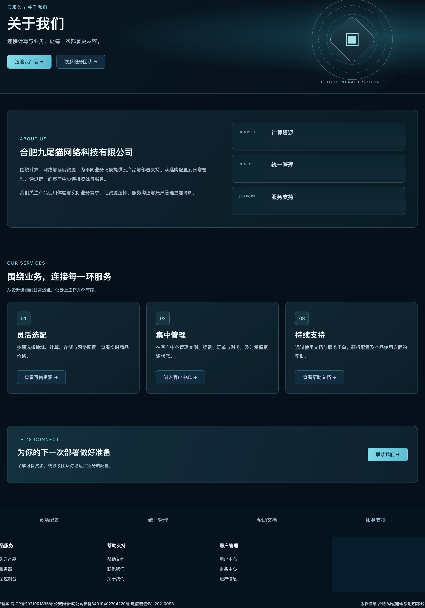
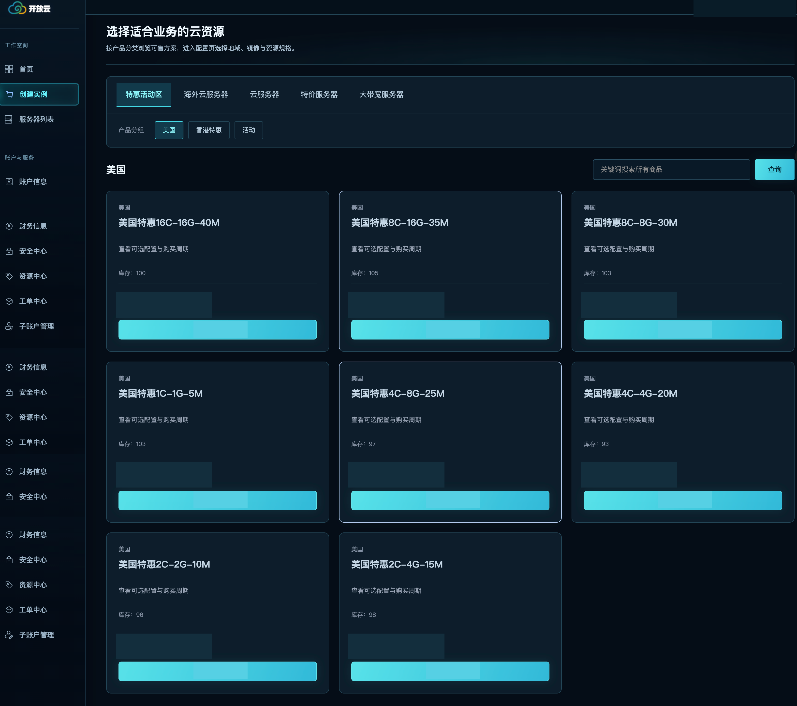
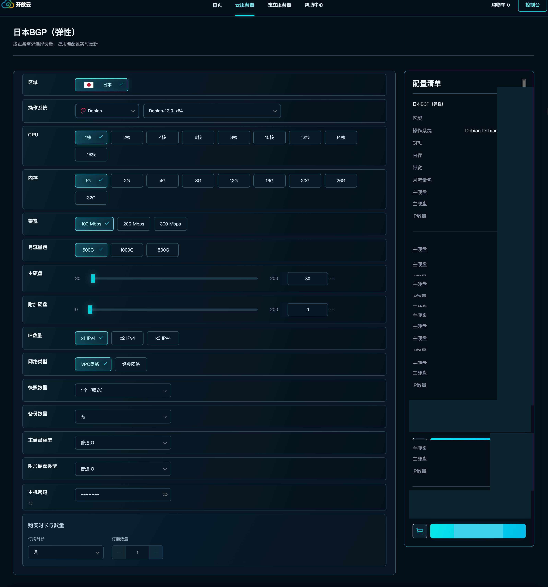
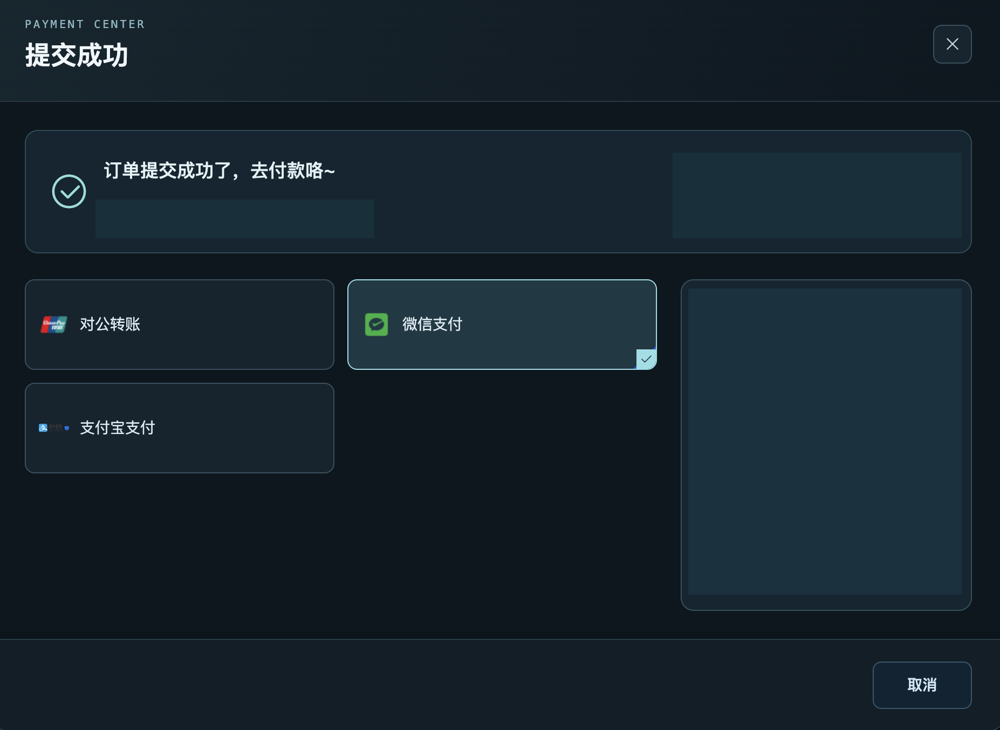
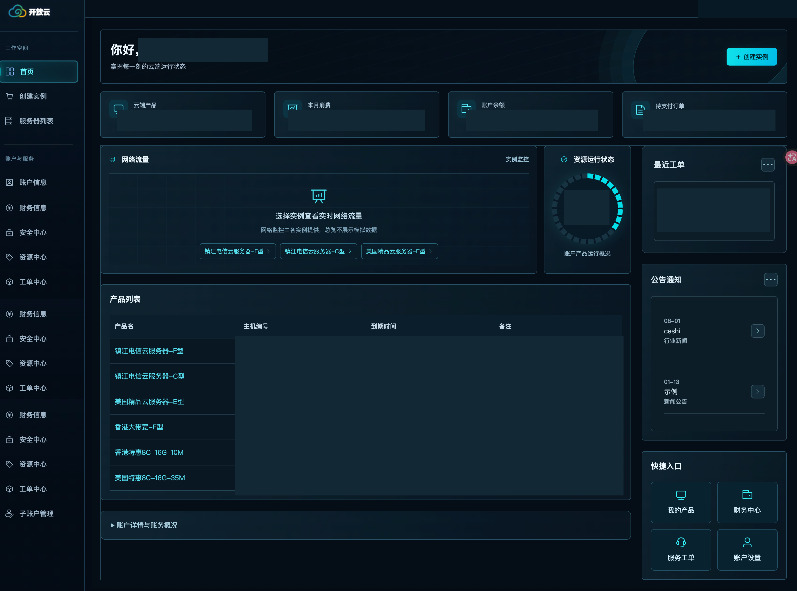
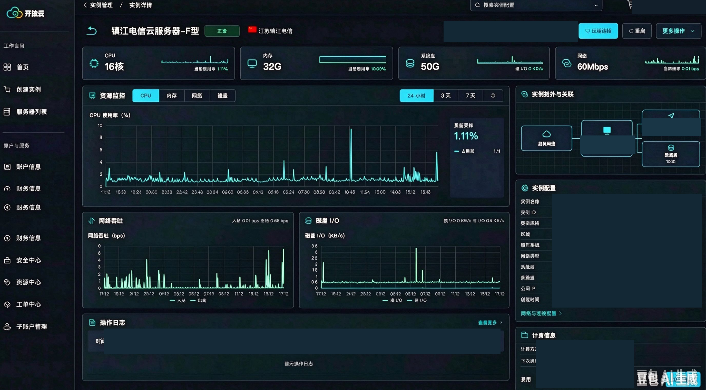
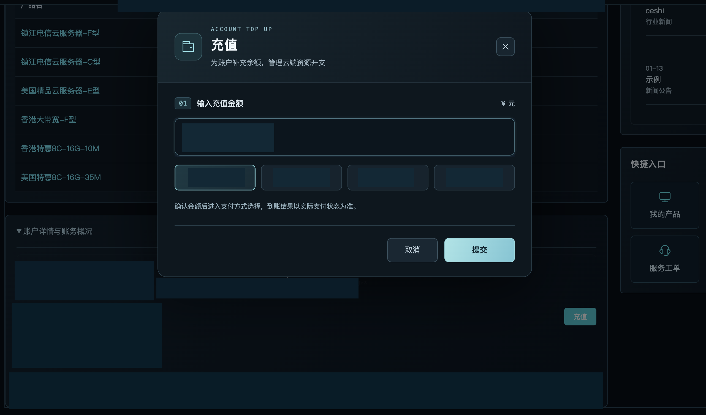
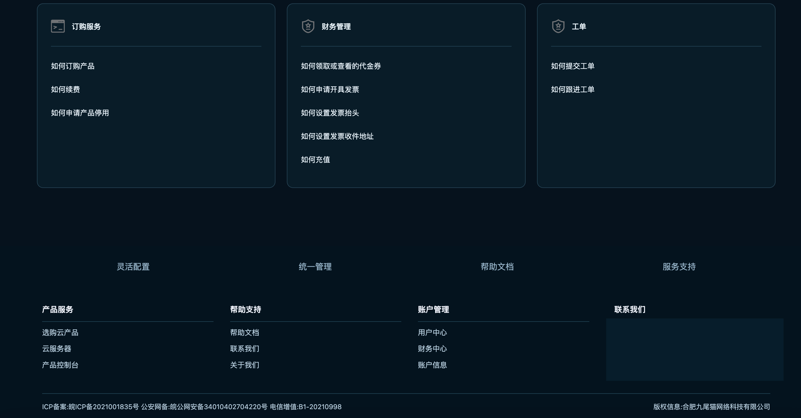
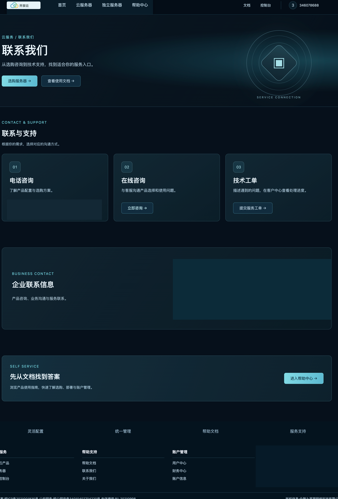

# 智简魔方 V10 · 云序耀黑主题

云序耀黑主题用深色背景和青蓝色强调导航、选配按钮与数据图表。可先看深色表单里的选中状态，再看登录后的产品列表和账务弹窗。

图集按首页、选购、结算、登录和售后操作排列。截图中的账户信息、订单编号、二维码和部分数字已遮挡。

## 界面预览

### 官网首页

### 品牌介绍

### 商品列表

### 商品选购

### 订单提交界面

### 登录页

### 用户中心

### 服务详情与监控

### 充值界面

### 帮助与文档

### 联系与支持

## 兼容性核对

上线前在测试站用与正式站一致的 V10 小版本及商品模块，试一次配置变更，核对购物车和订单详情。测试账号登录后，再检查用户中心和服务详情。

[330 电子商城商品资料](https://x330.com/shop/18)
